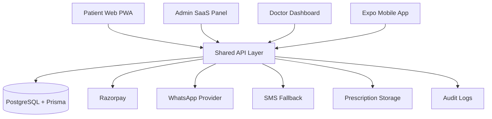

# Architecture

NeighborDoc uses a modular monorepo so patient, doctor, admin, and mobile clients share the same business rules.

## Packages

- `packages/shared`: pure functions and types. This is where emergency detection, pricing, doctor assignment, SLA, and authorization live.
- `packages/api`: service functions for auth, payments, consultations, WhatsApp, and provider abstractions.
- `packages/database`: Prisma schema and seed data.
- `packages/ui`: React UI primitives shared by web apps.

## Apps

- `apps/web`: patient acquisition and consultation booking.
- `apps/admin`: SaaS operations and analytics.
- `apps/doctor`: doctor queue and prescription workflow.
- `apps/mobile`: Expo Android/iOS patient app.
