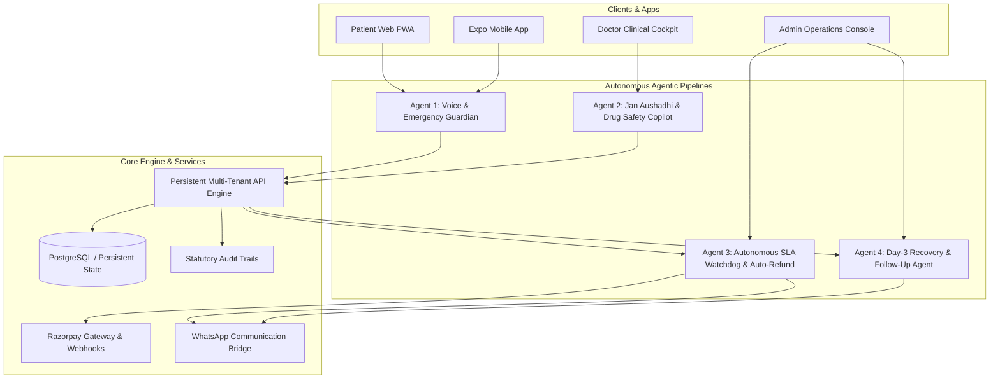

# Architecture & Autonomous Agentic Pipelines

NeighbourDoc is an enterprise-grade telehealth platform owned and operated as the proprietary property of **Qsura India Pvt. Ltd.**, conceived, founded, and architected by **Dr. Irfan Ashraf**. It uses a unified modular monorepo ensuring patient web, doctor cockpit, admin SaaS, and Expo mobile clients share the exact same healthcare compliance rules, statutory drug safety audits, and autonomous pipelines.

---

## 🤖 Autonomous Healthcare Agents

### 1. Voice-First Rural Triage & Emergency Red Flag Guardian
- **Location**: `apps/web/app/booking-form.tsx`, `apps/mobile/src/screens/BookScreen.tsx`
- **Capabilities**:
  - Web Speech API voice dictation for Hindi / rural vernacular dialects.
  - Multi-lingual real-time analysis against 40+ emergency red flags (*chest pain*, *cyanosis*, *snake bite*, *seizure*, *poisoning*).
  - Immediate pre-submission block with 1-click direct dials to National Emergency `112`, Ambulance `108`, and Poison Control `1800-116-117`.

### 2. Jan Aushadhi Generic Medicine & Rx Compliance Copilot
- **Location**: `packages/shared/src/index.ts`, `packages/api/src/index.ts`, `apps/doctor/app/doctor-dashboard.tsx`
- **Capabilities**:
  - Live PMBJP generic mapping for 15+ top essential molecules in India (Paracetamol, Amoxicillin+Clavulanate, Azithromycin, Pantoprazole, Metformin, etc.), delivering 60–80% savings.
  - Strict enforcement of *Telemedicine Practice Guidelines 2020* (blocks Schedule X narcotics and psychotropics).
  - Printable Rx generic breakdown card.

### 3. Autonomous SLA Watchdog & Auto-Refund Pipeline
- **Location**: `packages/api/src/index.ts`, `apps/web/app/api/admin/sla-watchdog/route.ts`, `apps/admin/app/admin-dashboard.tsx`
- **Capabilities**:
  - Scans active paid consultations.
  - **T + 8 Minutes**: Auto-reassigns to the next verified clinician with urgent push alert.
  - **T + 15 Minutes**: Automatically triggers full gateway refund, logs audit trail, and dispatches an apology WhatsApp message.
  - Real-time countdown radar in Admin Console.

### 4. Day-3 WhatsApp Patient Recovery & Follow-up Agent
- **Location**: `packages/api/src/index.ts`, `apps/web/app/api/admin/follow-up/route.ts`, `apps/web/app/api/consultations/[id]/follow-up/route.ts`
- **Capabilities**:
  - Automatically identifies consultations 72 hours post-completion.
  - Sends interactive WhatsApp check-in with quick numeric responses (1: Recovered, 2: Mild symptoms, 3: Worsened).
  - Condition worsening immediately escalates case to clinical priority and alerts the doctor.

---

## 📦 Package Structure

- `packages/shared`: Pure domain logic, Zod validation schemas, Jan Aushadhi catalog, drug schedules, and access control models.
- `packages/api`: Persistent API engine, JWT signing, Razorpay HMAC verification, watchdog agents, and WhatsApp dispatcher.
- `packages/database`: PostgreSQL Prisma schema, repository layer, and seed scripts.
- `packages/ui`: Shared Tailwind design system primitives (Surface, MetricCard, Buttons).

## 🚀 Applications

- `apps/web`: Patient PWA with voice intake, Razorpay UPI modal, and printable digital Rx.
- `apps/admin`: Operational SaaS console with live SLA radar and settings management.
- `apps/doctor`: Clinical cockpit with Jan Aushadhi Copilot and drug safety audits.
- `apps/mobile`: Cross-platform React Native / Expo application with emergency guardian and PMBJP generic breakdown.
